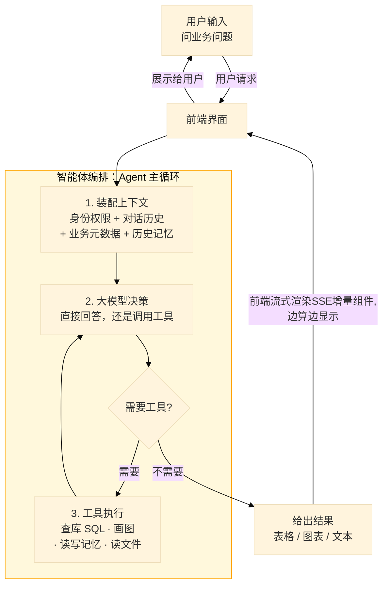
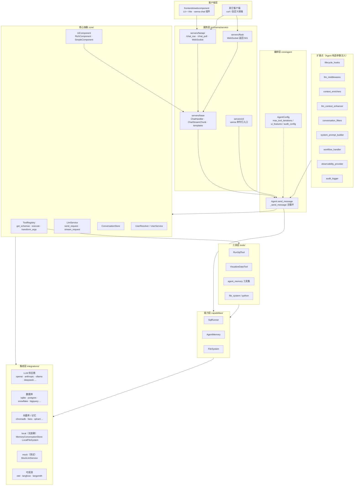
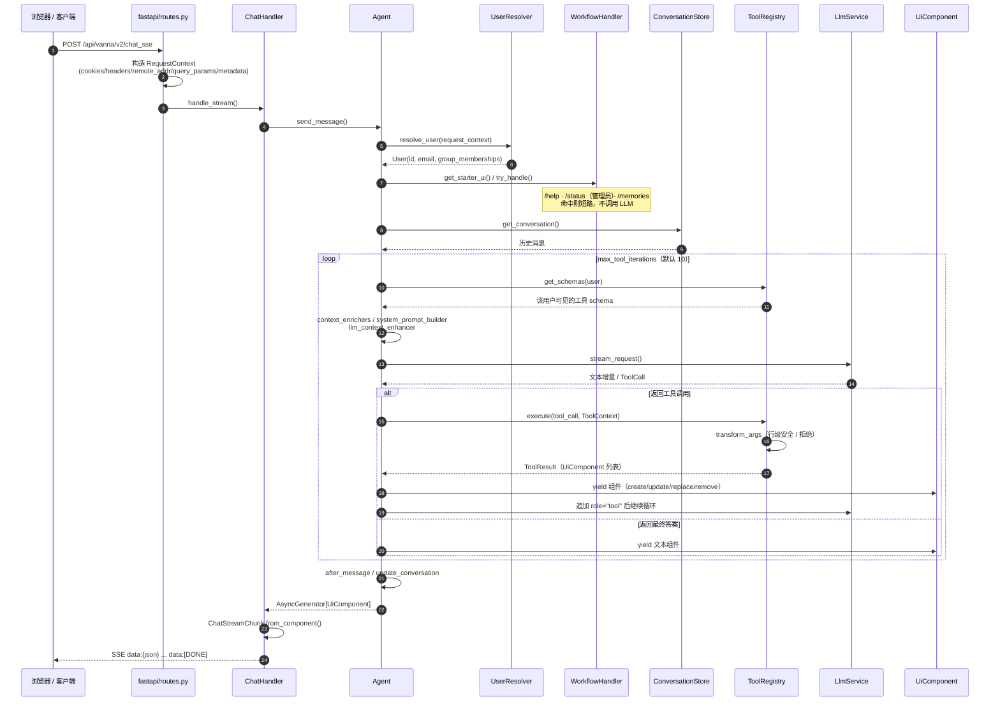
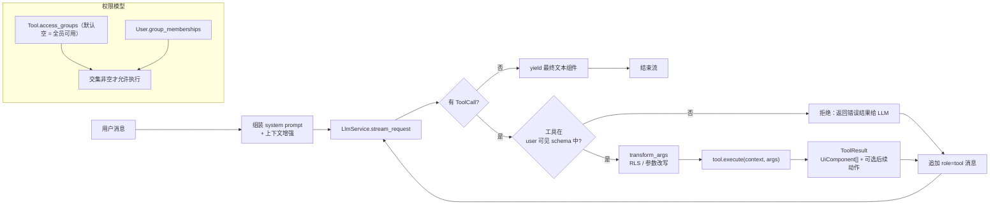
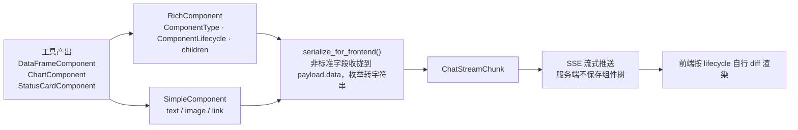

# Vanna 2.0 架构图

> 依据 `src/vanna` 当前代码结构绘制。Mermaid 图可在 CodeBuddy / VS Code 的 Markdown 预览、GitHub 上直接渲染。

## 0. 一张图看懂

**产品做什么**：用户用自然语言提问，Vanna 自动完成「查库 → 算数 → 画图 → 总结」，把结果以表格、图表、文本卡片等 UI 组件流式返回到聊天界面。

**怎么实现**：把一次提问拆成三步——装配上下文、让大模型决定调哪个工具、把工具产出的组件流式推给前端；三者在一个循环里反复迭代，直到模型给出最终答案。

一句话：**自然语言进，结构化分析结果出**；编排靠 `Agent` 主循环，能力靠可插拔的 `Tool` + 供应商集成（大模型、数据库、向量库），展示靠统一的 `UiComponent` 流。

## 1. 分层总览

## 2. 一次对话的请求时序

## 3. 工具调用与权限控制

## 4. 组件渲染链路

## 5. 模块职责速查

| 目录 | 职责 |
| --- | --- |
| `core/agent/` | `Agent` 编排器与 `AgentConfig` |
| `core/tool/` `core/registry.py` | `Tool` 抽象、`ToolRegistry`、权限与 `transform_args` |
| `core/llm/` | `LlmService` 抽象与请求/响应模型 |
| `core/user/` | `User`、`RequestContext`、`UserResolver`、`UserService` |
| `core/storage/` | `ConversationStore` 抽象（默认实现见 `integrations/local`） |
| `core/` 下的扩展点子包 | `lifecycle`、`middleware`、`enricher`、`enhancer`、`filter`、`workflow`、`observability`、`audit`、`system_prompt` 的抽象与默认实现 |
| `core/evaluation/` | 评估框架：`TestCase`、`Evaluator`、`EvaluationRunner`、报告导出 |
| `core/components.py` `rich_component.py` `simple_component.py` | `UiComponent` 双表示传输契约 |
| `capabilities/` | `SqlRunner`、`AgentMemory`、`FileSystem` 可替换后端 |
| `tools/` | 内置工具：`run_sql`、`visualize_data`、`agent_memory`、`file_system`、`python` |
| `integrations/` | 各供应商实现；`local/` 无依赖基础实现，`mock/` 供测试 |
| `servers/` | `base` 框架无关层、`fastapi`（默认）、`flask`、`cli` |
| `legacy/` | 冻结的 1.x 实现与 `LegacyVannaAdapter` 桥接（只读） |
| `frontends/webcomponent/` | Lit + Vite 的 `vanna-chat` Web 组件 |

## 6. 要点

- 全链路只有一个数据类型：`AsyncGenerator[UiComponent, None]`；Web 层仅做编码转换，服务端无组件状态。
- 扩展优先，不改主循环：通过 `Agent.__init__` 的扩展点列表注入行为（`error_recovery_strategy` 目前已声明但未在 `agent.py` 中调用）。
- 权限基于「分组交集」，默认 `Tool.access_groups = []` 表示全员可用；SQL 等敏感信息的可见性由 `UiFeature` 控制（默认仅管理员）。
- 新增公共名称需同时更新 `core/__init__.py` 与 `vanna/__init__.py`。
